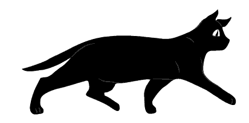

  <picture>
    <source media="(prefers-color-scheme: dark)" srcset="assets/loader/cat-inline-dark.webp">
    <source media="(prefers-color-scheme: light)" srcset="assets/loader/cat-inline.webp">
    
  </picture>
  <h1>Pet Worth</h1>

Pet Worth — мобильное приложение для заботы о питомцах. Профили, медицинская история, фотографии и PDF-документы, календарь и напоминания помогают держать важное под рукой и вовремя возвращаться к заботе о здоровье.

  
  

  <a href="docs/README.md">Документация</a>

